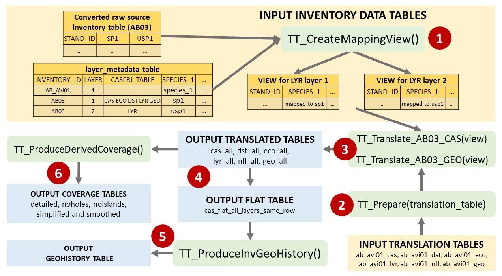
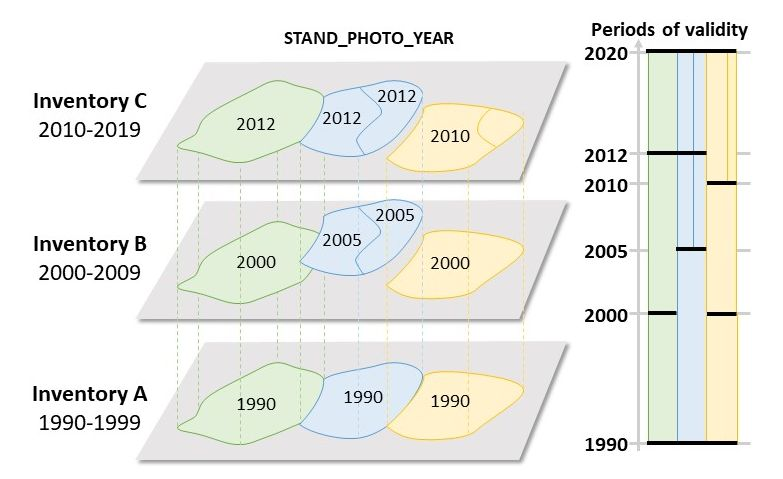
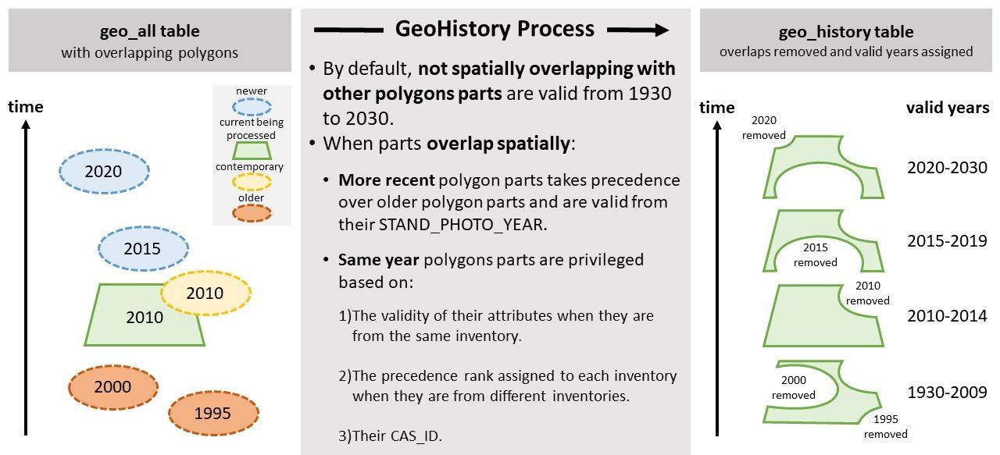

[](https://casfri.github.io/CASFRI/)

https://casfri.github.io/CASFRI/

# Introduction

In this document, column names are in UPPERCASE and values in lowercase unless their required spelling uses capitals, such as `'LYR'`. Code examples retain their actual spelling.

Digital Forest Resource Inventories (FRIs) are compiled by provincial and territorial governments and are key inputs into forest management planning. They have also been used widely to model species habitat in the Canadian boreal forest and, in combination with climate and weather data, to model wildfire size and frequency. FRI datasets consist of stand records interpreted from aerial photography at scales ranging from 1:10,000 to 1:40,000. They are typically conducted on a 10- to 20-year cycle and may be periodically updated to reflect changes such as burned areas, harvesting, insect damage, silviculture, and forest growth. The records estimate the location, extent, condition, composition, and structure of the forest resource. Each jurisdiction has developed its own procedures and standards for forest inventories. 

The Common Attribute Schema for Forest Resource Inventories (CASFRI) harmonizes FRI data from each jurisdiction in Canada, allowing a national FRI relational database to be created with continuous coverage. CASFRI reconciles the many differences in variable formats, attributes, and standards among those disparate inventories. Harmonization allows models to be developed using data from multiple jurisdictions or inventory versions.

The [CASFRI specifications](https://github.com/CASFRI/CASFRI/tree/master/documentation/specifications) documents the CAS database schema. It focuses on the most common attributes that are consistently recorded in forest inventories across Canada and which are relevant to habitat modeling and state of forest reporting. These attributes include crown closure, species composition, height, mean canopy or stand origin age, stand structure, moisture regime, site class or site index, non-forested cover types, non-vegetated cover types, and disturbance history.

A number of CASFRI instances have been produced since 2009. CASFRI 5 is the fifth version of CASFRI. It introduces a number of significant updates to previous versions:

* A number of new and more up-to-date inventories.
* A new conversion and loading procedure based on the open source software GDAL/OGR (in place of ArcGIS).
* A new [SQL-based translation framework](https://github.com/CASFRI/PostgreSQL-Table-Translation-Framework) that abstracts translation logic away from SQL implementation details and centralizes it within dedicated translation tables.
* A temporalized version of the database resolving overlaps in space and time over the many inventories.
* A new descriptive error code system.

The four main steps involved in the production of the CASFRI database are:

1. **Conversion** (from many different FRI file formats) and loading (into a PostgreSQL database) using Bash scripts and ogr2ogr.
2. **Translation** of the raw loaded FRIs to the CASFRI schema inside PostgreSQL.
3. **Denormalization** of the normalized CASFRI tables into one flat table.
4. **Temporalization** of CAS data inside PostgreSQL.

Note that forest resource inventories are not provided with this project due to the numerous licensing agreements that have to be passed with the different production jurisdictions. Many provincial inventories are now openly distributed and can be downloaded for free from government web sites. It is the responsibility of the user to get and integrate those inventories into his CASFRI installation. All the inventories supported by CASFRI are documented in [the inventory_metadata.csv](https://github.com/CASFRI/CASFRI/blob/master/metadata/inventory_metadata.csv) table.

# Version Number Scheme

CASFRI follows the [Semantic Versioning 2.0.0](https://semver.org/) versioning scheme (major.minor.revision) adapted for a dataset. Increments in revision version numbers are for bug fixes. Increments in minor version numbers are for new features, support for new inventories, additions to the schema (new attributes), and bug fixes. Increments in minor versions should not break backward compatibility with code referring to the CASFRI schemas. Increments in major version numbers are for schema changes that break backward compatibility with existing code (e.g. renaming attributes, removing attributes, changing the structure of attribute values and inventory support deprecation).

The current version is 5.3.1 and is available for download at https://github.com/CASFRI/CASFRI/releases/tag/v5.3.1

# Directory Structure
<pre>
./                                      Sample files for configuring and running scripts

./conversion                            Bash scripts for converting and loading FRI datasets into PostgreSQL/PostGIS

./docs                                  GitHub enabled website

./documentation/specifications          CASFRI specifications document

./helperfunctions                       CASFRI specific helper functions used in translation tables

./helperfunctions/geohistory            Functions used to build the geo-historical version of CASFRI

./metadata                              Main inventory and layer medadata files and loading script

./summary_statistics                    R scripts to summarize CASFRI output for validation checks

./translation/tables                    Translation tables and associated loading scripts

./translation/test                      Regression tests for CASFRI translations

./workflow/01_develTranslationTables    Translation scripts used for development and testing on sample versions of source tables

./workflow/02_produceCASFRI             Translation scripts to run all complete translations

./workflow/03_flatCASFRI                Scripts to build a flat (denormalized) version of CASFRI

./workflow/04_produceHistoricalTable    Scripts to build a geo-historical version of CASFRI and for computing inventories coverage polygons
</pre>

# Requirements

The production process of CASFRI 5 requires:

* A Bash shell environment to control CASFRI command line .sh scripts. We use git-bash on Windows. Is should which come with every Git installation. We use the default Bash shell on Linux.

* GDAL v3.10.x. We use the [Conda package](https://anaconda.org/channels/conda-forge/packages/gdal/overview) on Windows and either the compiled or the APT package on Linux.

* PostgreSQL 13.1+ and PostGIS 3.1+ to store and translate the data (PostgreSQL 11/12 and PostGIS 2.3.x have also been tested). More recent versions should work as well.

* The [PostgreSQL Table Translation Framework](https://github.com/CASFRI/PostgreSQL-Table-Translation-Framework) to be able to write simple translation tables instead of writing SQL functions (in most cases).

# Vocabulary
**Source data -** Raw FRI data received from jurisdictions.

**Loaded source table -** Raw FRI data converted and loaded into PostgreSQL.

**Target table -** FRI table translated into the CASFRI specifications.

**Translation table -** User created table detailing the validation and translation rules and converted to SQL queries by the PostgreSQL Table Translation Framework.

**Lookup table -** User created table used in conjunction with the translation tables; for example, to recode provincial species lists to a standard set of 8-character codes.

**Translation framework -** The [PostgreSQL Table Translation Framework](https://github.com/CASFRI/PostgreSQL-Table-Translation-Framework).

**Helper function -** A set of PL/pgSQL functions used in the translation table to facilitate validation of source values and their translation to target values.

# FRI and Inventory Standard Identifiers
CASFRI 5 identifies each FRI with a unique four-character code in the `INVENTORY_ID` column. This code is composed of two letters for the province or territory, and two numbers that increment for each new FRI added for that province/territory (e.g. BC01). Higher numbers do not necessarily imply more recent inventories. Sometimes newly acquired older inventories are added to the metadata table and are assigned a higher identifier.

Inventory standards define the attribute specifications (i.e., the data dictionary) used for a given inventory. Each jurisdiction has their own unique inventory standards. Multiple FRIs, from the same province or territory, can use the same standard. Jurisdictions occasionally update or redesign their standards, resulting in either a new version number or a markedly different standard. Translating inventories to the CASFRI specifications requires different sets of translation tables for different inventory standards. Each standard is assigned a code made of three letters identifying the standard, and two numbers identifying the version of the standard (e.g. VRI01). These codes are listed in the [inventory_metadata](https://github.com/CASFRI/CASFRI/blob/master/metadata/inventory_metadata.csv) table and used to name the translation tables and the translation functions.

# Handling Updates
Historical forestry data are highly valuable for forest research. For this reason, CASFRI accommodates both older inventories and subsequent updates. One common type of update in FRIs is re-inventories, in which legacy photo-interpretation data are revised to meet modern standards. Another type of update is the so-called "depletion updates" which compile newly identified disturbances. In many jurisdictions, depletion-updates are produced annually to "cut-in" polygons disturbed by harvesting, wildfire or insects activity.

Both types of updates are incorporated in CASFRI 5 by loading and translating the updated dataset and assigning it an incremented identifier in the `INVENTORY_ID` column. Any duplicate records are subsequently resolved through the temporalization procedure.

To be incorporated into the database, an update should have a publication date at least one year later than the previous version. When data are publicly available, this information can typically be found in the metadata.

# Conversion and Loading
Conversion and loading are performed simultaneously using the GDAL ogr2ogr tool. Each source FRI has it's own dedicated loading script that generates a single target table in PostgreSQL. If a source FRI consists of multiple files or multiple relational tables, the conversion/loading scripts append all files or tables into a single target flat database table, thereby eliminating schema complexity and facilitating translation. Some FRIs include an additional shapefile linking each stand to a photo year; these are loaded in the database using a separate script. 

Each loading script also adds two columns to the source table: the `SRC_FILENAME` column, containing the name of the source file, and the `INVENTORY_ID` column, containing the unique inventory identifier. These columns are subsequently used to construct values in the `CAS_ID` column, uniquely identifying each polygon and allowing each translated row to be traced back to its original row in the source dataset.


## Supported File Types
All conversion/loading scripts are provided as .sh files invoking ogr2ogr, ogrinfo and/or psql commands.

Currently supported FRI formats are:

* Geodatabase
* Shapefile
* Arc/Info Binary Coverage

Arc/Info E00 files are not currently well supported by GDAL/OGR. Source tables in this format should be converted into a supported format using another software package before loading (e.g. to a file geodatabase).

## Projection
All source tables are transformed to the Canada Albers Equal Area Conic (ESRI:102001) projection by GDAL/OGR during loading.

## Configuration File
A config.sh file is required in the CASFRI root directory to define local paths and user-specific configuration variables. A template file, config_sample.sh, is provided and should be copied and modified to reflect the local environment. The configuration script is self-explanatory: its comments describe the configuration variables and how to use them.

## Source Data Folder Structure
Conversion and loading scripts are written so that FRIs to convert and load must be stored in a specific folder hierarchy (using inventory AB06 as an example):

```text
FRI/NB/AB06/
  data/archive/       Original delivery archives
  data/inventory/     Extracted inventory datasets
  data/coverage/      Coverage or boundary data
  data/photoyear/     Separate photo-year data, when supplied
  doc/archive/        Original documentation archives
  doc/emailexchange/  Acquisition and clarification correspondence
  doc/manual/        Data dictionaries and interpretation standards
  doc/manual/others/ Supporting references
  doc/map/           Reference maps
  license/           License and permission records
  toclassify/        Material awaiting classification
FRI/NB/AB07/
...
```

# Translation
Translation of loaded source tables into target tables formatted to the CASFRI specification is done using the [PostgreSQL Table Translation Framework](https://github.com/CASFRI/PostgreSQL-Table-Translation-Framework). The translation framework uses a translation table that describes rules to validate each loaded source table and translate each row into the target table. Validation and translation rules are defined using a set of helper functions that both validate the source attributes and translate into the target attributes. For example, a function named isBetween() validates that the source data is within the expected range of values, and a function named mapText() maps a set of source literal values to a set of target values. A list of all helper functions is available in the [PostgreSQL Table Translation Framework README](https://github.com/CASFRI/PostgreSQL-Table-Translation-Framework). After the framework has processed all loaded source tables, the result is a complete set of target tables, each with matching attributes as defined by the CASFRI standard. 

## Translation Tables
A detailed description of the translation table structure is included in the [PostgreSQL Table Translation Framework README](https://github.com/CASFRI/PostgreSQL-Table-Translation-Framework). In short, each translation table lists the set of attribute names to be translated, their data type in the target table, a set of validation helper functions which all input values have to pass, and a set of translation helper functions to translate input values to CASFRI values. A set of generic helper functions are included with the [PostgreSQL Table Translation Framework](https://github.com/CASFRI/PostgreSQL-Table-Translation-Framework). They are used to perform common validations and translations in many different translation tables. The CASFRI project also has its own more specific set of [helper functions](https://github.com/CASFRI/CASFRI/tree/master/helperfunctions) that apply more complex translations specific to individual inventories.

CASFRI is composed of seven relational tables as detailed in the [CASFRI specifications](https://github.com/CASFRI/CASFRI/tree/master/documentation/specifications):
1. **Header (HDR) -** Summarizing reference information for each dataset;  
2. **CAS Base Polygon (CAS) -** Describing the source polygon and any identifiers;  
3. **Forest-Level (LYR) -** Describing productive and non-productive forest land;  
4. **Non-Forest Land (NFL) -** Describing non-forested land;  
5. **Disturbance history (DST) -** Describing the type, year and extent of disturbances;  
6. **Ecological specific (ECO) -** Describing wetlands;  
7. **Geometry attributes (GEO) -** Polygon geometries.

In general, each standard for each jurisdiction uses a single set of translation tables. All source datasets using the same standard should use the same set of translation tables. Differences in attribute names can be accommodated using the workflow scripts described below. In some cases minor differences in attributes between datasets using the same standard can be accommodated by designing translation helper functions that can deal with both formats. An example would be two datasets using the same standard, but different values for graminoids (e.g. 'Grm' in one dataset and 'graminoids' in another). These can be passed to a single translation function, dealing with all possible values, in the translation table (e.g. mapText(source_value, {'Grm', 'graminoids'}, {'GRAMINOID', 'GRAMINOID'})).

## Row Translation Rule
An important feature of the [PostgreSQL Table Translation Framework](https://github.com/CASFRI/PostgreSQL-Table-Translation-Framework) is `ROW_TRANSLATION_RULE`, which filters source rows so that only relevant records are translated into the target CASFRI table. This ensures that the LYR table for example, only includes rows that actually contain forest layer information.

## Error Codes
Error codes are needed during translation when source values are invalid, null, or missing. In CASFRI 5, error codes have been designed to match the attribute type and to reflect the type of error that was encountered. For example, an integer attribute will have error codes reported as integers (e.g. -8888) whereas text attributes will have errors reported as text (e.g. NULL_VALUE). Different error codes are reported depending on the rule being invalidated. A full description of possible error codes can be found in the [CASFRI specification](https://github.com/CASFRI/CASFRI/tree/master/documentation/specifications).

## Validating Translations
Validation is performed at multiple stages during and after translation:

* **Validation of translation tables by the translation framework** - The [PostgreSQL Table Translation Framework](https://github.com/CASFRI/PostgreSQL-Table-Translation-Framework) validates that translation tables are well formed prior to attempting translation.

* **Validation of source values** - All source values are validated by validations rules before attempting translation using the [PostgreSQL Table Translation Framework](https://github.com/CASFRI/PostgreSQL-Table-Translation-Framework) validation helper functions and/or the [CASFRI validation helper functions](https://github.com/CASFRI/CASFRI/blob/master/helperfunctions/helperFunctionsCASFRI.sql).

* **Validation of the translated CASFRI** - The [constraints](https://github.com/CASFRI/CASFRI/tree/master/workflow/02_produceCASFRI/03_ConstraintsChecksAndIndexes) scripts adds a set of database constraints to the translated tables. These constraints ensure that the translated data conform to the CASFRI standard as outlined in the [CASFRI 5 specification document](https://github.com/CASFRI/CASFRI/tree/master/documentation/specifications).

* **Overall review of translation tables** - The TT_StackTranslationRules() function creates a table of all translation and validation rules used for all inventories for a given CASFRI table. This allows visual review of all translation rules and assignment of error codes for a given attribute.

* **Validation of output using summary statistics** - The [summary_statistics](https://github.com/CASFRI/CASFRI/tree/master/summary_statistics) folder contains scripts (primarily summarize.R) to produce summary statistics for all attributes in each source inventory. These scripts use the R programming language and require that R be installed (https://www.r-project.org/). The output is a set of html files containing the summary information. These can be used to check for outliers, unexpected values, correct assignment of error codes etc.

## Workflow Scripts
The [./02_translateAll.sh](workflow/02_produceCASFRI/02_translateAll.sh) script translates selected inventories using the `TT_TranslateInventory()` database procedure. For manual development, the same process can be performed by calling three functions in order:

* TT_Prepare() to validates and compile the translation table into a TT_TanslateXXX() function.
* TT_CreateMappingView() to create a VIEW mapping the raw inventory tables attribute names to the translation tables attribute names.
* TT_Translate_XXX() generated by TT_Prepare() to actually translate the values from the VIEW to the CASFRI tables.
  
`TT_TranslateInventory()` carries out those three operations together. It can also be called directly from a database query window with `CALL`; see [Database Procedures](#database-procedures).

TT_Prepare() is part of the PostgreSQL Table Translation Framework. It is described in detail in the [PostgreSQL Table Translation Framework](https://github.com/CASFRI/PostgreSQL-Table-Translation-Framework) along with explanations on how to write translation tables. 

It is important to understand that a single translation table can be used for multiple translations, either for different layers within the same inventory, or for different inventories using the same standard but different attributes names. The workflow scripts accommodate this by combining three elements:

### 1. Placeholder names in translation table helper functions

In CASFRI, helper functions used in the translation tables `VALIDATION_RULES` and `TRANSLATION_RULES` columns use placeholder attribute names instead of actual source inventory attribute names. Every translation using a common translation table to translate similar inventories map inventory attribute names to these placeholder column names. This mapping is defined in the `layer_metadata.csv` table described below. That's how a single translation table can be reused to translate many inventories from the same jurisdiction. Otherwise many translation tables using the same helper functions but with different attribute names would have to be created. In the workflow scripts, the `layer_metadata.csv` table is used to create VIEWs mapping the source inventory attribute names to the placeholder attribute names found in the translation table. One can then run the same translation using as many different VIEWs as there are source inventories and layers.

### 2. layer_metadata table

`layer_metadata.csv` matches source columns and input layers to the names expected by reusable translation tables. Each source inventory row lists all source attributes needed to produce the target CASFRI attribute values. The same source attribute may appear several times because it is used to produce several target values.

* **INVENTORY_ID -** Identifies a standard mapping, such as `AB_AVI01`, or a source inventory, such as `AB03`.
* **LAYER -** Identifies the source layer whose attributes are mapped by an inventory row. Its number does not necessarily match the final CASFRI layer number.
* **CASFRI_TABLE -** Lists the tables supplied by that row: CAS, ECO, DST, LYR, NFL, or GEO.
* **TTABLE_EXISTS -** Distinguishes standard rows (`yes`) from inventory rows (`no`).

The remaining cells contain the standard's expected names or the corresponding source-column names and fixed values. Match their order when listing several inputs.

You can read this file like this (e.g. for inventory AB16): "When translating the AB16 layer 2 attributes values to the  AVI01 standard attribute (e.g. stand_structure) using the AB_AVI01 LYR translation table, map these columns names (e.g. std_struct, nat_nonveg, anth_noveg, anthro_veg, nonfor_veg, sp1, sp2, sp3, us_sp1, us_sp2, us_sp3
) to these columns names (stand_structure, nfl, anth_veg, anth_non, nat_non, species_1_layer1, species_2_layer1, species_3_layer1, species_1_layer2, species_2_layer2, species_3_layer2)."

As another example, NB08 maps the `l1s1` source column name to the `species_1` standard name for layer 1 and `l2s1` to the same name for layer 2. The value validation and translation actual processing code remains in the translation tables and helper functions.

A **fixed value** is supplied directly to every record in a mapping instead of being read from a source column. See [section 3.1 of the detailed procedure](documentation/new_inventory_ingestion_procedure.md#31-add-mapping-rows-in-layer_metadatacsv) for examples, quoting rules, and `NULL` handling.

### 3. TT_CreateMappingView()

This function is used to create the VIEWs mapping the raw inventory tables attribute names to the translation tables placeholder names according to the mapping found in the layer_metadata table. TT_CreateMappingView() is also used to create random selections of source rows for development or testing purpose. It takes the following arguments:

* **schemaName -** name of the schema the source inventory was loaded to.
* **fromTableName -** identifier of the source inventory in the `INVENTORY_ID` column of the layer_metadata table from which to map the attribute names.
* **fromLayer (default to 1) -** matches the `LAYER` column in the layer_metadata table.
* **toTableName (default to fromTableName) -** identifier of the translation standard in the layer_metadata table to which to map the attribute names (prefixed with the jurisdiction code. e.g. "bc_vri01").
* **toLayer (default to 1) -** matches the `LAYER` column in the layer_metadata table (for our purposes this is always set to 1).
* **randomNb (default to all rows) -** number of random rows to select. If blank, all rows are selected.
* **viewNameSuffix (default to "")-** suffix to give to the VIEW created.

The function creates a VIEW with a name based on the input arguments:

* If only 'fromTableName' is provided, a VIEW with only the mapped set of attributes is created (without mappings). For example `SELECT TT_CreateMappingView('rawfri', 'ab03', 200);` creates a VIEW named **ab03_min_200** in the **rawfri** schema listing only the attributes listed for the first layer of AB03.

* If both 'fromTableName' and 'toTableName' are provided without 'fromLayer' and 'toLayer', the 'fromTableName' attribute names of layer 1 are mapped to the 'toTableName' attribute names of layer 1 (i.e. the translation table placeholder names). For exampe `SELECT TT_CreateMappingView('rawfri', 'ab03', 'ab_avi01');` creates a VIEW named **ab03_l1_to_ab_avi01_l1_map** in the **rawfri** schema.

* When 'fromLayer' and 'toLayer' integers are provided, the row corresponding to the provided layer numbers will be used for the mapping. For example `SELECT TT_CreateMappingView('rawfri', 'ab03', 2, 'ab_avi01', 1);` creates a VIEW named **ab03_l2_to_ab_avi01_l1_map** in the **rawfri** schema.

* When 'randomNb' is provided, the VIEW produces that number of randomly selected rows and the VIEW name is suffixed with that same number. For example `SELECT TT_CreateMappingView('rawfri', 'ab03', 2, 'ab_avi01', 1, 200);` creates a VIEW named **ab03_l2_to_ab_avi01_l1_map_200** in the **rawfri** schema.

The following diagram illustrates, using a simple attribute (species_1), how:

1. The layer_metadata table is used by the TT_CreateMappingView() function to produce VIEWs on the different layers of forest data from the converted raw source inventory tables.

2. The TT_Prepare() function uses the translation tables to produce input-agnostic TT_Translate_XX00_YYY() translation functions.

3. The TT_Translate_XX00_YYY() functions use data from the VIEWs to produce the six CASFRI translated tables (cas_all, dst_all, eco_all, lyr_all, nfl_all and geo_all).
   
Validation and translation rules in the translation tables always use the same VIEWs attribute names when reused to translate different versions of the same inventory or different layers within that inventory. The VIEWs, which map the different source data names to those used in the translation tables, allow the same translation table to be reused for multiple inventories and layers avoiding lots of code duplication.

Each inventory and each layer is translated by a different query using the proper VIEW. For the layer 1 translation, the source attribute sp1 is mapped to the placeholder name (species_1). For the layer 2 translation, the understory attribute usp1 is also mapped to the same placeholder name (species_1) because the logic for translating layer 1 and layer 2 are the same.

The diagram also shows how :

1. The CASFRI translated tables are denormalized to a flat table including the two first layers in the same row.

2. The GeoHistory table is produced from the flat table with TT_ProduceInvGeoHistory().

3. The coverage polygons of all inventories are produced with TT_ProduceDerivedCoverage()


<p align="center">
  
  <br>
  <em>Figure 1. CASFRI processing workflow: source inventory columns are mapped to translation attribute names and translated to the 6 CASFRI tables. Those tables are used to produce a denormalized (flat) table, the geohistory table and inventory coverage maps.</em>
</p>

# CASFRI Geo-Historical Table
The six tables found in the 'casfri50' schema as the result of a complete translation gathers stands from many inventories, where polygons sometimes overlap each other in space or/and time (e.g. BC08, BC10 and BC11). That means if you try to match an observation point made at a specific year, you might end up with more than one matching stand. Either because they overlap in space (some inventories have many polygons of the same year overlapping each other), in time (the valid time of one inventory (e.g. 2000-2010) overlaps the valid time of the following inventory (2008-2015)) or both.

The geo-historical version of the CASFRI database introduces a new geometry table, replacing the "geo_all" table, in which no two polygons occupy the same space at a given point in time (i.e. no two polygons overlap in space and time). In this table, stand polygons are cut so that only polygons parts from the most accurate inventory at the date of observation can be matched. It allows querying for the best available inventory information at any point in time accross the full CASFRI coverage.

The geo-historical table is created using the scripts found in the workflow/04_produceHistoricalTable folder. The .sh script are to be used to run the process for multiple inventories in parallel from the Bash shell and the .sql script are to be used from pgAdmin or psql with more control over the process. These scripts are:

* **01_PrepareGeoHistory.sh and 01_PrepareGeoHistory.sql** overwrite the default TT_RowIsValid() and TT_HasPrecedence() functions, create the geo_history table and split the whole CASFRI geometry coverage into a grid for easier spatial processing.

* **02_ProduceGeoHistory.sh and 02_ProduceGeoHistory.sql** process each gridded polygon one by one. The algorithm uses the value in the `STAND_PHOTO_YEAR` column for each polygon as the reference date to determine its valid start and end year. Each polyon is intersected with all other overlapping polygons and the resulting polygon parts are assigned values in the `VALID_YEAR_BEGIN` and `VALID_YEAR_END` columns. In the case of overlaps, the polygon with the most complete and accurate information is prioritized as described below. Both scripts use the TT_ProduceInvGeoHistory() function.

* **03_ProduceInventoryCoverages.sh and 03_ProduceInventoryCoverages.sql** produce a set of tables containing different versions of coverage polygons for each inventory. Both scripts use the TT_SuperUnion() and the TT_ProduceDerivedCoverages() functions.

Valid start and end years are assigned using the following rules:
* Each polygon is assigned values in the `VALID_YEAR_BEGIN` and `VALID_YEAR_END` columns based on the value in the CAS table's `STAND_PHOTO_YEAR` column. By default, at the end of the process, if a polygon does not overlap with another one in space and time, `VALID_YEAR_BEGIN` is set to `1930` and `VALID_YEAR_END` to `2030` since this polygon and its associated attributes are the best information we have for this area for all this period of time.
  
* When two polygons overlap:

  * More recent polygons take precedence over older polygons starting at the year in their `VALID_YEAR_BEGIN` column. For example, a polygon from 2010 takes precedence over a 2000 polygon starting in year 2010. The 2000 polygon has precedence from 1930 until 2009 and the 2010 polygon has precedence from 2010 to 2030.

  * When both polygons have the same value in the `STAND_PHOTO_YEAR` column, the polygon with valid values takes precedence over polygons with invalid values. Invalid values are defined as all significant CASFRI attributes being NULL or empty. This rarely happens, but if it does, the polygon with valid values takes precedence.

  * When both polygons have the same value in the `STAND_PHOTO_YEAR` column and valid values but come from different inventories, the polygon from the higher precedence inventory, as established by the TT_HasPrecedence() function and the `PRECEDENCE_RANK` column of the inventory_metadata.csv table, takes precedence. For example, if the values associated to two overlapping 2010 polygons are all valid but the first polygon comes from AB10 and the second comes from AB16, then TT_HasPrecedence() states that the AB16 polygon takes precedence.

  * When both polygons have the same value in the `STAND_PHOTO_YEAR` column, valid values and the same TT_HasPrecedence() rank, then both polygons are sorted by the unique identifier in the `CAS_ID` column and the first one has precedence over the second one.

<p align="center">
  
  <br>
  <em>Figure 2. Photo years determine when inventory information is valid for each stand. Successive inventories contain stand information interpreted from aerial photographs taken in different years, both within and between inventories, so the period for which that information is valid is specific to each stand.</em>
</p>

No interpolation, interpretation or correction of attribute values is performed when generating the geo-historical table. For this reason the geo-historical table can be queried to recreate the 'state of the inventory' for a given year, but not necessarily the 'state of the forest'. The 'state of the inventory' is the best available information for a given point in time, whereas the 'state of the forest' would require assigning the best forest attributes for every year based on time since disturbance considering all the information found in the numerous historic inventories. This is beyond the scope of this project, but the geo-historical table could facilitate such modelling exercises for interested end users.

The following diagram illustrates the temporalization procedure for a single polygon:

<p align="center">
  
  <br>
  <em>Figure 3. Resolving overlaps for a single polygon. Photo years and priority rules determine which overlapping information is retained, producing polygon parts with defined start and end years of validity.</em>
</p>

The geo-historical table can be queried using the `VALID_YEAR_BEGIN` and `VALID_YEAR_END` columns. For example, the following query selects the polygon intersecting each observation point and valid in its observation year:
```
SELECT p.id, p.year, p.geom, gh.cas_id
FROM mypointable p, casfri50_history.geo_history gh
WHERE ST_Intersects(gh.geom, p.geom) AND gh.valid_year_begin <= p.year AND p.year <= gh.valid_year_end;
```
The resulting table can then be joined, using the `CAS_ID` column, with:

  a) one of the two flat tables from the casfri50_flat schema or
  b) one of the CASFRI normalized tables from the casfri50 schema (cas_all, dst_all, eco_all, lyr_all, nfl_all).

# Database Procedures

All three tasks below require the [Shared preparation](#shared-preparation) section. Complete it for the database you will use, then follow the numbered procedure for your task:

| Task | Result |
| --- | --- |
| [Build the whole database from scratch](#build-the-whole-database-from-scratch) | A new database containing all selected inventories and the denormalized (flat) tables, historical tables, and coverage tables |
| [Translate a new inventory](#translate-a-new-inventory) | One additional inventory translated and tested, while existing inventory results are preserved |
| [Produce a new release](#produce-a-new-release) | A fully tested, documented version published on GitHub, following the release procedure |

Building a database or translating an inventory does not by itself create a release.

## Shared preparation

### Prepare required software and configuration variables

Set up the required software and configuration variables before running the database scripts:

- Use the software listed under [Requirements](#requirements).

- Copy [config_sample.sh](config_sample.sh) to `config.sh` if needed, then set the source-data locations, database connection, and processing variables, following the explanatory comments in the file.

- Keep `targetFRISchema=rawfri` for loaded source tables and `targetTranslationFileSchema=translation` for translation tables, as required by the current SQL procedures.

- On Windows, use Git Bash to run `.sh` scripts. Prefix the script path with `./`, for example `./convert_all.sh` or `bash ./convert_all.sh`. Here, `./` means the current folder. Run each workflow script from the folder containing it, because several scripts use file locations relative to that folder. See [Open a Git Bash command window](#open-a-git-bash-command-window) below for instructions on opening the window and using commands.

- Use pgAdmin or `psql` to run SQL files.

### Open a Git Bash command window

On Windows, open the Start menu, type **Git Bash**, and select the Git Bash application. If the shortcut is unavailable, open File Explorer and double-click `C:\Program Files\Git\git-bash.exe` on this computer. Git Bash is included with Git for Windows; if it is not installed on another computer, install Git for Windows before continuing.

In the Git Bash window, go to the main CASFRI folder. Enter the following commands pressing Enter after each line:

```bash
cd /d/CASFRI/
pwd
ls README.md common.sh config_sample.sh
```

Git Bash writes the Windows path `D:\CASFRI` as `/d/CASFRI`. If the project is elsewhere, change the path accordingly. Put a path containing spaces in double quotation marks, for example `cd "/d/My Projects/CASFRI"`. The `pwd` command displays the current folder. The `ls` command should list the three named files. If it reports that a file cannot be found, check that you opened the main project folder before proceeding.

Copy each Bash example into this window using Shift+Insert or the window's Paste command. Copy only the commands, without the surrounding Markdown backticks. For commands spread across several lines, copy the complete block and keep the backslash `\` at each continued line's end. Press Enter if needed to start the last line, then read the messages and wait for the command prompt to return before continuing. Some scripts open additional windows; check their results too.

Press **Up Arrow** to recall the last command. Edit it if needed, then press **Enter** to run it again. Press **Up Arrow** repeatedly to recall earlier commands.

Keep the window open for later Bash examples. Start each example from the main CASFRI folder unless a different folder is specified. If you close the window, open Git Bash again and repeat the folder-navigation commands above. If you have moved to another folder, use `cd /d/CASFRI` to return before starting the next example. Run any `source ./common.sh` line included in an example as well; it reads the configuration variables needed by that example.

### Install the PostgreSQL Table Translation Framework

Install and test the framework in the database you will use for CASFRI:

- Enable PostGIS with `CREATE EXTENSION postgis;`.

- Run the framework's [./install.sh](https://github.com/CASFRI/PostgreSQL-Table-Translation-Framework/blob/master/install.sh). It places `table_translation_framework--x.y.z.sql` in PostgreSQL's `share/extension` folder.

- Enable the framework in the database with `CREATE EXTENSION table_translation_framework;`.

- Run the framework's `engineTest.sql`, `helperFunctionsTest.sql`, and `helperFunctionsGISTest.sql` to test the installation.

### Install or replace the CASFRI helper functions

These database functions complement the PostgreSQL Table Translation Framework helper functions with CASFRI-specific validation and translation functions. Use the following instructions for a first installation or to replace an existing installation:

- Select the target database in pgAdmin and open its Query Tool.

- **For a first installation:** open [helperFunctionsCASFRI.sql](helperfunctions/helperFunctionsCASFRI.sql) in the Query Tool and execute the entire file, then run the tests described below.

- **To replace an existing installation:** wait until no translation is running. Keep PostGIS and the Table Translation Framework installed throughout the replacement, and perform the following operations in the same database.

- First, execute `SELECT TT_DropAllTranslateFct();` to remove translation functions and procedures.

- Next, open [helperFunctionsCasfriUninstall.sql](helperfunctions/helperFunctionsCasfriUninstall.sql) and execute the entire file. It removes the CASFRI helper functions and supporting and test views, including dependent objects where specified by the script.

- Check for errors, then execute the entire [helperFunctionsCASFRI.sql](helperfunctions/helperFunctionsCASFRI.sql) file again to reinstall the functions and procedures.

- **After either installation or reinstallation:** execute [helperFunctionsCASFRITest.sql](helperfunctions/helperFunctionsCASFRITest.sql). A successfull test should display no rows. Review and resolve any failed tests before translating inventories.

For every inventory being translated, verify these requirements:

- [inventory_metadata.csv](metadata/inventory_metadata.csv) contains one row identifying and documenting the inventory and its standard. Many metadata values must be filled in for the whole translation process to work properly. See the [inventory metadata table](documentation/new_inventory_ingestion_procedure.md#required-inventory-metadata-columns) in the detailed procedure for the complete list, their uses, and how expected stand counts affect processing order.

- [translation/tables](translation/tables) contains the required translation CSV tables, named by jurisdiction, the value in the `STANDARD_ID` column, and CASFRI table, for example `bc_vri01_dst.csv`.

- [layer_metadata.csv](metadata/layer_metadata.csv) contains the standard's general column names under an identifier such as `BC_VRI01`, plus a row for each inventory input layer. The `CASFRI_TABLE` column lists the tables supplied by each row, and its source column names correspond to the names referenced in the translation tables.

[./load_tables.sh](translation/load_tables.sh) loads the translation and lookup tables and reloads both metadata files. Use [./load_metadata.sh](metadata/load_metadata.sh) when only metadata needs reloading. The [Workflow Scripts](#workflow-scripts) section explains how to perform the following three operations individually:

1) Prepare the inventory's translation functions from the loaded translation tables using `TT_Prepare()`.

2) Create database views that match source column names and forest layers to the names referenced in those translation tables using `TT_CreateMappingView()`.

3) Run the prepared translation functions on those views and insert the results into the CASFRI tables.

After the source data, metadata, and translation tables have been loaded, run these three operations together with `CALL TT_TranslateInventory('AB03');`, replacing `AB03` with the inventory identifier.

Translation adds rows to `casfri50.cas_all`, `dst_all`, `eco_all`, `lyr_all`, `nfl_all`, and `geo_all`. `hdr_all` describes each inventory and is populated from inventory metadata. Repeating a translation does not automatically replace its earlier rows.

## Build the whole database from scratch

Use this procedure to create a complete database from supported inventories.

Conversion, translation, production of the geo-historical table and production of the inventory coverages are all very long processes when dealing with many inventories. In its current state, with more than 50 inventories supported, the final cas_all table gathers more than 66 million stands. If you include the other CASFRI tables (eco_all, dst_all, lyr_all, nfl_all and geo_all) that's more than 225 million rows translated. If you multiply this by the number of attributes composing each CASFRI table you get more than 3 billion values to translate. Even for a powerful database management system like PostgreSQL/PostGIS, that's a lot of information to process. The whole process described in this section should take many days to complete.

The Bash batch scripts below run separate processing jobs in parallel on the same computer. Where corresponding SQL scripts are provided, you can run them individually for closer monitoring and troubleshooting. The numbered steps give the processing order; the parallel configuration variables control how many jobs run together within each stage.

### 1) Create and configure a new database

Create an empty PostgreSQL database and complete the [Shared preparation](#shared-preparation) section from the main README for it.

### 2) There are five ways to determine the list of inventories to translate

#### a) Use one of the inventory_metadata file predetermined list

Set `metadataTableLoadingColumn` in `config.sh` to the name of the `TRANSLATED_BY_CFS` or `TRANSLATED_BY_ULAVAL` column. All the inventories marked as YES in that column of [inventory_metadata.csv](metadata/inventory_metadata.csv) will be converted and translated. You must leave `fullList` undefined in `config.sh` for this to work. It's good practice to review which inventories are marked as YES before proceeding.

#### b) Use the inventory_metadata file customizable list

Set `metadataTableLoadingColumn` to the name of the `TRANSLATED_BY_CUSTOM` column, and set all required inventories to `YES` in this column in [inventory_metadata.csv](metadata/inventory_metadata.csv). Similarly you must leave `fullList` undefined in `config.sh` for this to work. You can also add your own column and set `metadataTableLoadingColumn` to it.

#### c) Use a short, temporary list

For a short, temporary selection, such as reprocessing inventories that failed after a complete run or translating a set of newly acquired inventories, define `fullList=(AB03 AB06)` in `config.sh`. This overrides predetermined or custom lists defined in the inventory_metadata.csv table. The configuration can assemble `fullList` from smaller lists defined in other variables such as `invList1` and `invList2`; the only variable used by the various scripts is `fullList`. The script always gives you the opprtunity to review and confirm the list that will be processed before continuing.

#### d) List the inventories directly when calling a processing script

Most processing scripts also accept inventory identifiers on the command line. This is usefull if you need to reconvert or retranslate only a couple of inventories. The script always gives you the opprtunity to review and confirm the list that will be processed before continuing. This overrides the `fullList` defined in `config.sh`.

### 3) Set how many processes can run at the same time

Adjust `maxConversionInParallel`, `maxTestsInParallel`, `maxTranslationsInParallel`, and `maxGeoHistoryInParallel` in `config.sh` to suit the computer's CPU cores, available memory, and disk capacity. Conversion and historical processing involve substantial disk access and computation, so their maximums should be lower than the translation and test maximums. For each process, batch scripts start separate command processes up to the configured maximum and automatically start another one as soon as one finishes.

### 4) Optionally keep command windows open to inspect results or errors

To keep command windows open and check or inspect any error when converting, testing, translating, producing the geohistory table of the coverage polygons, set the appropriate `leaveXXXShellOpen` setting to `True`. This will prevent each command window to close automatically. If you do so, new command processes will not start automatically and you will have to close each one individually in order for the next one to start by itself. This is better used when the list of inventories to process is short. Otherwise there will be many windows to close for the whole process to complete and if you take a lot of time to close them, the whole conversion/translation process will take much longer.

### 5) Convert and load the inventories

Run [./convert_all.sh](conversion/convert_all.sh) from the `conversion/` folder. All inventories defined by `fullList` or the metadata/inventory_metadata.csv `TRANSLATED_BY_XXX` column will be converted/loaded to PostgreSQL/PostGIS.

The `photoYearList` configuration variable identifies specific scripts loading shapefiles shared by several inventories. When no inventory identifiers are supplied on the command line, these datasets are loaded once before the conversion batch, so each inventory can reuse them without loading them again. This loading is repeated on each such conversion run. Supplying inventory identifiers skips automatic photograph-year loading; in an existing database, reuse the shared tables already loaded and load required datasets separately only if they are missing or need updating.

### 6) Check the converted record counts

Review the counts of converted/loaded polygons displayed at the end of conversion. They are compared with expected counts defined in the `CONVERTED_STAND_CNT` column of the [inventory_metadata.csv](metadata/inventory_metadata.csv) table. This count takes some time. You can prevent the count to be processed by setting `postProcessing` in `config.sh` to False. You can also run only the counts by setting `postProcessingOnly` to True in the same file. Another way to check for the counts is execute the `SELECT * FROM TT_ConvertedStandCount();` SQL query directly in the database. You can restrict the list of inventory for which to produce a count like this: `SELECT * FROM TT_ConvertedStandCount(ARRAY['AB03', 'AB06']);`.Investigate and resolve unexpected differences before continuing.

### 7) Load the translation tables

Run [./load_tables.sh](translation/load_tables.sh) from the `translation/` folder to load the translation tables in the database.

### 8) Check sample test translations before launching the full translation

Run [./test_translation.sh](translation/test/test_translation.sh) for the selected inventories. It runs `CALL TT_RunAllTests('$prov', '$casTable');` for each select inventory and each CAFRI table, writes results to the `casfri50_test` database schema, and exports CSVs for comparison with expected results. Resolve unexplained differences. See the [translation test instructions](translation/test/readme.md) for detailed instructions about these tests.
    
### 9) Create the CASFRI tables and translate all selected inventories

From `workflow/02_produceCASFRI`, run [./01_createCASFRITables.sh](workflow/02_produceCASFRI/01_createCASFRITables.sh), then [./02_translateAll.sh](workflow/02_produceCASFRI/02_translateAll.sh). **CAUTION: 01_createCASFRITables.sh deletes and recreates all the CASFRI tables; use it only when existing tables can be discarded.**

### 10) Check the translated record counts

Review the counts displayed at the end of translation. They are compared with the expected counts in the `CAS_ROW_CNT`, `DST_ROW_CNT`, `ECO_ROW_CNT`, `LYR_ROW_CNT`, `NFL_ROW_CNT`, and `GEO_ROW_CNT` columns of [inventory_metadata.csv](metadata/inventory_metadata.csv). Counting can take time. To skip it during translation, set `postProcessing=False` and keep `postProcessingOnly=False` in `config.sh`. To run only the counts, set `postProcessingOnly=True` and rerun [./02_translateAll.sh](workflow/02_produceCASFRI/02_translateAll.sh) from `workflow/02_produceCASFRI`. Alternatively, you can execute the `SELECT * FROM TT_TranslatedRowCount();` SQL query directly in the database. You can restrict the list of inventory on which to produce a count like this: `SELECT * FROM TT_TranslatedRowCount(ARRAY['AB03', 'AB06']);`. Investigate and resolve unexpected differences before continuing, and explain any changes before updating expected counts.

### 11) Apply constraints, create indexes, and run additional checks

Run `01_addConstraints.sql`, `01_addGeoConstraints.sql`, `02_addIndexes.sql`, and `03_additionalChecks.sql` in [03_ConstraintsChecksAndIndexes](workflow/02_produceCASFRI/03_ConstraintsChecksAndIndexes). Review the applied constraints and investigate and resolve any failures or unexpected results.

### 12) Produce both denormalized (flat) tables

Run [./01_all_layers_same_row.sh](workflow/03_flatCASFRI/01_all_layers_same_row.sh) and [./03_one_layer_per_row.sh](workflow/03_flatCASFRI/03_one_layer_per_row.sh), or their corresponding SQL files. They create Materialised Views of the denormalized (flat) tables in the `casfri50_flat` schema. The first View models the first two forested layers in the same stand row. The second View models each stand layer in separate rows. The first View supplies the base table for the geo-historical process. Test the resulting Views with [02_all_layers_same_row_test.sql](workflow/03_flatCASFRI/02_all_layers_same_row_test.sql) for the table with layers on the same row and [04_one_layer_per_row_test.sql](workflow/03_flatCASFRI/04_one_layer_per_row_test.sql) for the table with one layer per row. Those tests check the number of rows produced. Review the test results and resolve any unexpected differences before continuing.

### 13) Produce the geo-historical table

Execute [geohistory.sql](helperfunctions/geohistory/geohistory.sql) in the database in order to define the necessary functions, then run [./01_PrepareGeoHistory.sh](workflow/04_produceHistoricalTable/01_PrepareGeoHistory.sh) and [./02_ProduceGeoHistory.sh](workflow/04_produceHistoricalTable/02_ProduceGeoHistory.sh) from the `workflow/04_produceHistoricalTable` folder. These scripts prepare the grid and historical tables and process the selected inventories into `casfri50_history`. Have a look at the [CASFRI Geo-Historical Table](#casfri-geo-historical-table) section for more details about the geohistory table. CAUTION: Production of the geohistory table might take a long time.

### 14) Produce inventory coverage maps

Run [./03_ProduceInventoryCoverages.sh](workflow/04_produceHistoricalTable/03_ProduceInventoryCoverages.sh) from the `workflow/04_produceHistoricalTable` folder to create the inventory coverage tables in `casfri50_coverage`.

### 15) Record the completed build

Investigate count discrepancies; update expected metadata counts only after confirming and documenting the correct values. Create GitHub issues for failed test results and other problems. Review, commit, and push any valid changes to GitHub. Follow the separate release procedure only when a published version number is required.

Parallel processing across inventories does not mean that every operation within one inventory uses several CPU cores. Further optimization of helper functions, including marking suitable functions `PARALLEL SAFE`, is still needed. Reporting progress has been prioritized where it is difficult to combine with parallel execution inside an individual inventory. These scripts do not allow distributing work across multiple computers.

## Translate a new inventory

Use this procedure to add and translate newly acquired inventories. Be careful of not deleting other existing converted and translated inventories from the database. See the [detailed inventory ingestion procedure](documentation/new_inventory_ingestion_procedure.md) for complete instructions, commands, examples, tests, and handling of existing tables.

### 1) Archive and document the new inventory

Determine an inventory identifier for the new inventory by looking at the existing ones in the [inventory_metadata.csv](metadata/inventory_metadata.csv) table. Just increase the last number used for a juristiction by 1 (e.g. AB35). Save the original files in the folder defined by the `friDir` `config.sh` variable in a folder hierarchy similar to other existing ones. Document its source, standard, dates, licensing, and expected counts in [inventory_metadata.csv](metadata/inventory_metadata.csv). Use the `COMMENT` column or the inventory's README to explain unusual file or layer choices and coordinate-system corrections, without duplicating names or coordinate-system information already preserved in the source files or conversion script. All columns are documented in the [detailed inventory ingestion procedure](documentation/new_inventory_ingestion_procedure.md) file.

### 2) Prepare the environment, convert and load the inventory

Check the [Shared preparation](#shared-preparation) section from the main README, create a new `conversion/sh/load_<inventory_id>.sh` based on an existing script dealing with the same type of source inventory files and run it. Check loaded counts and polygon shapes. If necessary update the actual count of loaded polygons in [inventory_metadata.csv](metadata/inventory_metadata.csv)

### 3) Prepare and validate the inventory translation

Add mapping rows in [layer_metadata.csv](metadata/layer_metadata.csv). Reuse existing translation tables as much as possible, making simple modifications while preserving correct translations of existing inventories. Create a new set for CAS, DST, LYR, NFL, ECO, and GEO only when substantial changes are needed or no suitable set exists. Load missing or modified translation and lookup tables with [./load_tables.sh](translation/load_tables.sh); omit filenames to reload them all. This script also reloads inventory and layer metadata.

Adapt a comparable development script in [workflow/01_develTranslationTables](workflow/01_develTranslationTables), updating its inventory identifier, standard identifier, and mapping-view names. Inspect as many mapped and translated sample rows as possible, including rare values, and examine distinct source values. Investigate error codes that may hide valid source values not handled by the rules, and fix any `TRANSLATION_ERROR` (`-3333`) bug. See [sample validation](documentation/new_inventory_ingestion_procedure.md#34-create-a-development-script-and-validate-sample-translated-rows) for queries and error-code details.

### 4) Translate the complete inventory

Run `TT_DropAllConstraints('casfri50', tableName)` for each of the six translated CASFRI tables before replacing the HDR record; keep HDR and its primary key. This allows parallel translation and can speed it up by postponing constraint checks and rebuilding primary-key indexes afterward. Replace only the new inventory's HDR row using the delete-and-insert transaction in [subsection 4.2 of the detailed procedure](documentation/new_inventory_ingestion_procedure.md#42-add-the-hdr-record).

Run [./02_translateAll.sh](workflow/02_produceCASFRI/02_translateAll.sh) from Git Bash with the new inventory identifier. It calls `TT_TranslateInventory()` for the six tables in parallel, up to `maxTranslationsInParallel`. Omitting inventory identifiers can select existing inventories from `fullList` or metadata and translate them again.

Wait for every translation process to finish. Check translated counts against metadata either by rerunning the script with `postProcessingOnly=True` or by executing `TT_TranslatedRowCount()`, following [subsection 4.4](documentation/new_inventory_ingestion_procedure.md#44-check-completion-and-reapply-the-constraints). Restore `postProcessingOnly=False` before further conversion or translation. Resolve unexpected counts, then run [01_addConstraints.sql](workflow/02_produceCASFRI/03_ConstraintsChecksAndIndexes/01_addConstraints.sql), followed by [01_addGeoConstraints.sql](workflow/02_produceCASFRI/03_ConstraintsChecksAndIndexes/01_addGeoConstraints.sql), to reapply and test the standard constraints. Resolve every failed check.

### 5) Generate, validate and archive test tables

Use the complete translation validated in step 4 as the reference. Define the number of random source rows in [translation/test/nb_tests_per_layer.csv](translation/test/nb_tests_per_layer.csv), setting `NB_TEST_ROWS` for each required inventory/CASFRI-table/input-layer combination. Run [./test_translation.sh](translation/test/test_translation.sh), then [validate_number_of_tests.sql](translation/test/validate_number_of_tests.sql) to check the translated test-row counts against the recommendations in [translation/test/readme.md](translation/test/readme.md).

Because `ROW_TRANSLATION_RULE` filters rows in tables such as LYR and NFL, the source sample size needed to produce a fixed number of translated test rows is not known in advance. As a result, you may need to adjust `NB_TEST_ROWS`, regenerate the test tables, and check their counts several times.

Sample tests cover CAS, ECO, DST, NFL, and LYR, excluding HDR and GEO. Use the HDR and GEO checks in step 4 and compare translated GEO coverage with the source polygons in your GIS, as explained in [subsection 5.1 of the detailed procedure](documentation/new_inventory_ingestion_procedure.md#51-define-the-number-of-rows-to-test-in-nb_tests_per_layercsv). Run [helperFunctionsCASFRITest.sql](helperfunctions/helperFunctionsCASFRITest.sql) for new or modified CASFRI helper functions. Review the generated test CSVs and compare results for affected existing inventories, including those sharing modified translation tables, lookup tables, or functions.

### 6) Record and share the work

Document final counts, test tables, and remaining problems; review the changed project files, including accepted test CSVs in `translation/test/tables/`, commit them, and push them to GitHub. If denormalized (flat) tables, coverage maps, or historical results must also include the new inventory, update those separately for the affected inventories without rerunning full-build initialization.

## Produce a new release

Use this procedure when preparing a named version for publication. It includes a complete build and additional checks of the code, installation, documentation, and release contents. Follow [documentation/release_procedure.md](documentation/release_procedure.md) for the detailed and complete release process.

### 1) Prepare the release

Choose the version number, close resolved issues, and create release issues and branches for CASFRI and the PostgreSQL Table Translation Framework. Organize the issues included in the release.

### 2) Convert and translate the whole list of inventories

Follow [Build the whole database from scratch](#build-the-whole-database-from-scratch) in a fresh database, using all inventories selected for the release.

### 3) Complete release testing

Follow the release guide's installation, uninstallation, and reinstallation checks; translation tests and validation; and denormalized (flat) table and [geohistory tests](helperfunctions/geohistory). Compare generated test files with accepted results and explain all changes.

### 4) Resolve release-blocking problems

Fix major issues preventing completion of the complete build, record failed checks and remaining problems as described in the release guide, and repeat affected tests. Leave unrelated improvements for later releases.

### 5) Commit and share corrections

Associate commits with the release and relevant issue numbers, push them to GitHub, and merge the release fixes into the main development branch.

### 6) Document and publish

Update version numbers, prepare release notes describing features, fixes, and known problems, create the GitHub releases, and close the release issues.

# Credits
**Steve Cumming**, Center for Forest Research, University Laval.

**Pierre Racine**, Center for Forest Research, University Laval.

**Marc Edwards**, database design, programming.

**Pierre Vernier**, FRI translations.

**Mélina Houle**, Center for Forest Research, University Laval.

**Morgan Thompson**, Canadian Forest Service. 

**John Cosco**, Timberline Forest Inventory Consultants (previous versions of CASFRI).

**Bénédicte Kenmei**, Center for Forest Research, University Laval (previous versions of CASFRI).

# Citation
Cumming, S.G., Racine, P., Edwards, M., Houle, M., Vernier, P., Thompson, M., Cosco, J. and Kenmei, B. (2021). Common Attribute Schema for Forest Resource Inventories (CASFRI). Université Laval, QC, Canada. URL https://casfri.github.io/CASFRI/.
